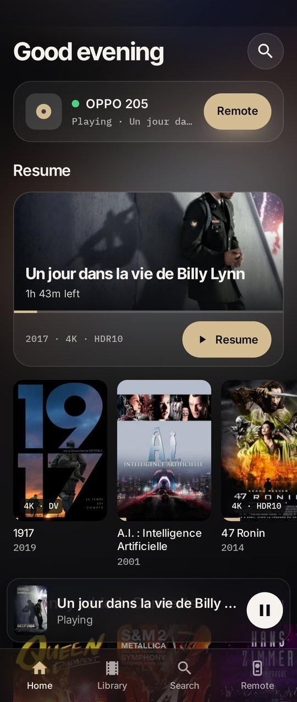
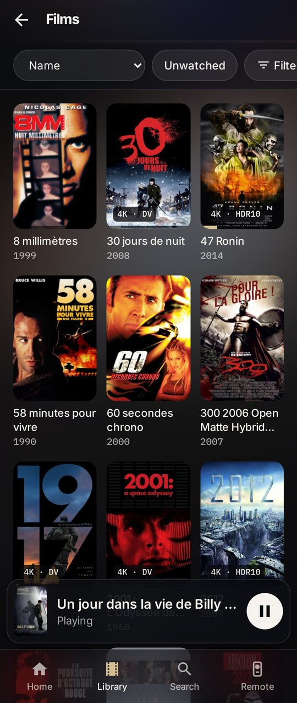
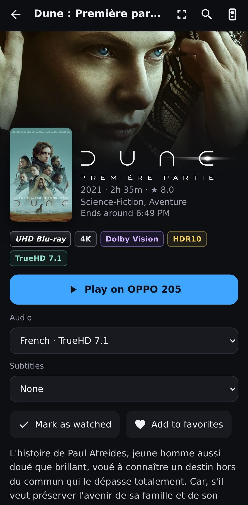
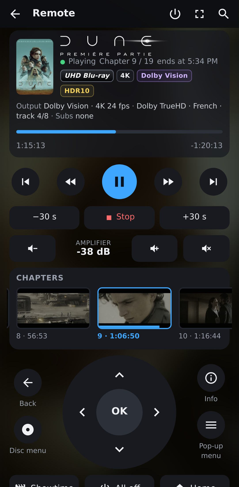
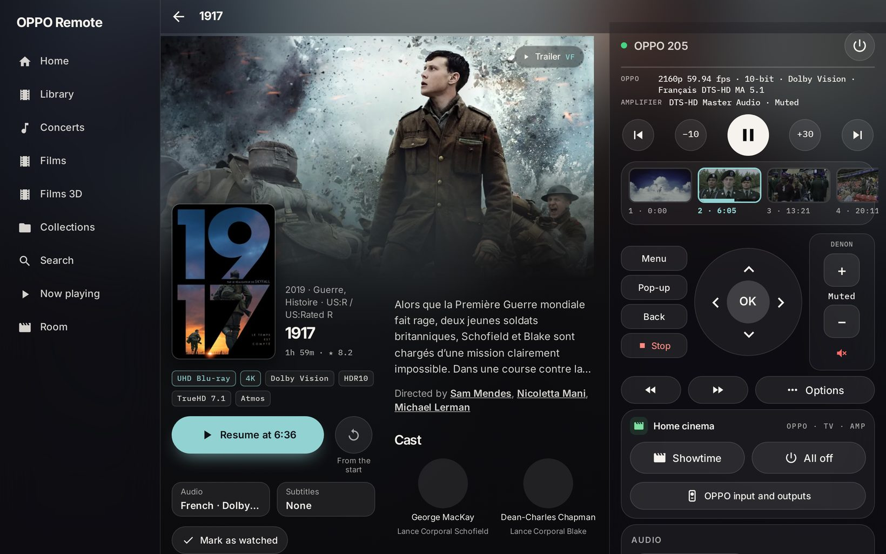

# Emby × OPPO UDP-203/205

Two Emby Server plugins and an Android app to play your library on an **OPPO UDP-203 / UDP-205** (or a compatible clone) straight from Emby. Supported sources are Blu-ray / UHD / DVD ISOs, BDMV and VIDEO_TS folders, MKV and other files. The OPPO plays the original file, so you keep full-quality audio and video, menus and Dolby Vision. Emby keeps track of progress.

Written from scratch using the OPPO's public IP control protocol and Emby's public plugin API. No third-party code is included.

The interface is available in **English and French**. The language follows the device or browser, and you can change it in the remote's settings.

## What's inside

| Component | What it does |
|---|---|
| **Emby.Oppo** (plugin) | **Playback:** adds the OPPO to Emby's "Play on…" menu. The player plays the original file, either sent over DLNA by the plugin (with the oppo-dv-mkv mod, see below) or from your share over NFS or SMB. Position is reported back to Emby, so resume and watched status work.<br>**Playback options:** audio and subtitle track selection, multi-disc titles, "Movie without menus" for Blu-ray discs, optional webhook for home automation.<br>**Web remote:** browse your libraries (filters by genre, era, video: 4K / Dolby Vision / HDR / 3D, audio: Dolby Atmos / DTS:X / TrueHD / DTS-HD MA / 7.1, duration), open a title page (format badges, including Atmos and DTS:X found in the audio itself), then control playback: chapter thumbnails, live OPPO output info (resolution, HDR, audio format), transport keys, a D-pad and a "Showtime" power scene.<br>**Updates:** from the plugin's settings page, in one click. |
| **Emby.IsoBluray** (plugin) | Reads inside Blu-ray ISOs and BDMV folders (UDF 2.50, MPLS playlists). Emby then shows the real audio and subtitle tracks, the correct runtime and the format (UHD, HDR…). Blu-ray 3D discs are marked as 3D. |
| **Android apps** | Fullscreen app for the web remote, with voice search and lock-screen media controls. It comes in two editions:<ul><li>**OPPO**: no home automation.</li><li>**OPPO Home**: adds Showtime, All off and the amplifier volume. The phone's volume keys control the amplifier while the app is open, and while a movie plays even with the screen locked.</li></ul>The interface is served by the plugin, so it updates without reinstalling the app. |

## Screenshots

The web remote, which is also what the Android apps show:

<p>
  
  
  
  
</p>

On a tablet in landscape, the remote stays on the right while you browse:



## Installing the plugins

Emby has no catalog for third-party plugins: they are installed by copying the DLL files into the `plugins` folder **of the computer or NAS that runs your Emby server**. Not the Plugins page of the dashboard, and not another computer where you only watch Emby.

1. Download `Emby.Oppo.dll` and `Emby.IsoBluray.dll` from the [Releases](../../releases) page. On Windows, right-click each file → **Properties** → tick **Unblock** if it is there.
2. Copy them into the `plugins` folder of your Emby configuration:
   - **Docker:** `<config volume>/plugins/` (the folder mapped to `/config`)
   - **Linux:** `/var/lib/emby/plugins/`
   - **Windows:** `%AppData%\Emby-Server\programdata\plugins\`
   - **Synology:** see below.
3. Restart Emby. Both plugins appear under **Dashboard → Plugins**.
4. Run *Dashboard → Scheduled tasks → "Blu-ray: tracks and runtimes"* once (see [Scheduled tasks](#scheduled-tasks)).

### On a Synology NAS

First check how Emby is installed: if **Emby Server** is listed in **Package Center → Installed**, follow the first method. Use the second one only if Emby already runs as a container in Container Manager (there is no need to install Container Manager otherwise).

**Emby from Package Center:** the plugins folder is inside a system folder that File Station cannot open, so DSM's Task Scheduler copies the files, with no command to type:

1. In **File Station**, upload the two DLL files directly into your **home** folder (not in a subfolder).
2. **Control Panel → Task Scheduler → Create → Scheduled Task → User-defined script.**
   - **General:** name it `Install OPPO plugins`, **User: root**.
   - **Schedule:** "Run on the following date", today, "Do not repeat".
   - **Task Settings:** paste this script into **User-defined script**, then **OK** (confirm the warning about root):
     ```sh
     F=$(ls /volume*/*/Emby.Oppo.dll /volume*/homes/*/Emby.Oppo.dll 2>/dev/null | head -n 1)
     [ -n "$F" ] || exit 1
     D=$(dirname "$F")
     P=/var/packages/EmbyServer/var/plugins
     [ -d "$P" ] || P=$(ls -d /volume*/@appdata/EmbyServer/plugins 2>/dev/null | head -n 1)
     if [ -z "$P" ] || [ ! -d "$P" ]; then echo "Emby plugins folder not found" > "$D/oppo-install.txt"; exit 1; fi
     {
       echo "DLL folder: $D"
       echo "Emby plugins folder: $P"
       cp "$D/Emby.Oppo.dll" "$D/Emby.IsoBluray.dll" "$P/" &&
       chown "$(stat -c %u:%g "$P")" "$P/Emby.Oppo.dll" "$P/Emby.IsoBluray.dll" &&
       chmod 644 "$P/Emby.Oppo.dll" "$P/Emby.IsoBluray.dll" &&
       /usr/syno/bin/synopkg restart EmbyServer &&
       echo "OK: plugins installed, Emby restarted"
     } > "$D/oppo-install.txt" 2>&1
     ```
3. Select the task and click **Run**. Emby restarts within a minute. The file `oppo-install.txt`, next to the DLLs, tells what happened. You can then delete the task: later updates are done from the plugin's page (the files belong to Emby's own user, so the plugin can replace them).

**Emby in Container Manager (Docker):**

1. In **Container Manager → Container**, open the Emby container → **Settings** → **Volume**, and note the folder mapped to `/config` (for example `docker/emby/config`).
2. In **File Station**, open that folder, then its `plugins` folder, and **Upload** the two DLL files.
3. In Container Manager, select the Emby container → **Action → Restart**.

Developed and tested with Emby Server 4.10 on Linux (Docker on a Synology NAS). The plugins are built against the 4.9 API, so 4.9 should work too. Windows servers should work (Windows paths are supported in the mappings) but have not been tested yet: feedback welcome.

## Configuration (Dashboard → Plugins → OPPO)

Open this page in a **web browser** (`http://<server>:8096`): plugin settings pages may not open in the Emby apps. Until the OPPO address is set, the remote shows "OPPO not set up".

- **OPPO address**
  - Give the player a fixed IP address.
  - In the OPPO network settings, enable **IP control**.
- **Path mappings**: for each library folder, tell the plugin how the OPPO can reach it.

  | Path as seen by Emby | Protocol | Server | Share |
  |---|---|---|---|
  | `/volume1/Movies` | NFS | `192.168.1.10` | `volume1/Movies` |
  | `/mnt/movies` | SMB | `nas.local` | `Movies` (+ username and password) |

  NFS is recommended, especially for BDMV folders. With DLNA (below), the share is only a fallback.
- **Play over DLNA** (optional, recommended with a modded player)
  - Needs the [oppo-dv-mkv](https://github.com/fandangos/oppo-dv-mkv) mod on the player, with **DLNA Disc Images** on (Setup → Extras).
  - The plugin then serves the movie itself and sends it to the player's DLNA renderer, with no share mounted. ISO files (Blu-ray, UHD, DVD), Blu-ray folders and DVD folders (`VIDEO_TS`) play as a disc (menus, Dolby Vision, lossless audio); MKV, MP4 and M2TS files play as files.
  - The plugin listens on its own port (**8099** by default, "Disc image server port"): it must be free on the Emby server and reachable by the player. With Docker, use host networking or publish this port.
  - Blu-ray folders are listed over WebDAV and the player builds the disc from that list: most discs start in 1 to 3 s, a UHD folder with many files can take 10 to 20 s.
  - If the movie does not start, the share above is used.
- **Webhook** (optional)
  - Called with `POST {"event":"detected"|"stopped"|"seance_on"|"seance_off","title":…}`.
  - For example, use it to have Home Assistant turn on the TV and AV receiver (`http://homeassistant:8123/api/webhook/<id>`).
- **Unfolded Circle remote** (optional)
  - Enter its address, API key and the TV's `media_player` entity.
  - The TV is then switched on over the network when a movie starts or when you press "Showtime". This helps when the Emby server cannot reach the TV with Wake-on-LAN.
- **Amplifier volume** (optional, Home Assistant)
  - Enter the Home Assistant address (e.g. `http://homeassistant:8123`), a long-lived access token (your profile → Security) and the amplifier's `media_player` entity (e.g. `media_player.denon`).
  - The remote then shows the volume with buttons for volume down, volume up and mute. In the **OPPO Home** app, the phone's volume keys control the amplifier while the app is open, and while a movie plays even with the screen locked.

Then, from any Emby app: **Play on… → OPPO**.

### Scheduled tasks

- Run *Dashboard → Scheduled tasks → "Blu-ray: tracks and runtimes"* once after installing. It analyses the Blu-ray ISOs and folders already in your library.
- *"OPPO: Dolby Atmos / DTS:X"* runs every night at 3 am (run it once by hand after installing). It finds the Atmos and DTS:X tracks of the titles that have a TrueHD or DTS track, for the audio filter of the web remote. About 7 minutes for 600 titles the first time, then only new titles.

### Updating

The plugin's settings page (*Dashboard → Plugins → OPPO*) shows the installed versions and the latest release. **Update** downloads both plugins from GitHub, checks them and replaces the installed files (the previous ones are kept in Emby's cache folder); **Restart Emby** then applies them. Administrators only. Versions older than 0.20.0 are updated once by hand.

## Web remote and Android app

- **Browser**
  - Open `http://<emby-server>:8096/emby/Oppo/Remote` and sign in with your Emby account.
  - In Chrome, the page can be installed as an app (PWA).
  - On Linux, GNOME Web can install it as a web application (menu → Install Site as Web Application).
  - On a slow device, tick **Light mode** at the bottom of the remote: fewer visual effects and smaller images.
- **Android app** (Android 7+)
  - Download `OPPO.apk` (no home automation) or `OPPO-Home.apk` (Showtime, All off, amplifier volume) from [Releases](../../releases), or use the install buttons on the web remote.
  - Allow installs from unknown sources.
  - On first launch, enter your Emby server address (e.g. `http://192.168.1.10:8096`).

## Building from source

```bash
# Plugins (.NET SDK 8). The Emby API comes from the MediaBrowser.Server.Core NuGet package.
dotnet build src/Emby.IsoBluray -c Release
dotnet build src/Emby.Oppo -c Release

# Android app (no Gradle). Needs Android SDK build-tools 35 and platform 34 in ~/android/sdk.
bash android/build.sh                               # both editions; creates a signing key on first run
cp android/build/oppo.apk android/build/oppo-home.apk src/Emby.Oppo/Remote/   # embed them, then rebuild Emby.Oppo

# Icons (Android launcher + web remote) from tools/icon.svg. Needs Node.js and Playwright.
node tools/make_icons.js
```

## Movie without menus

On the title page of a Blu-ray or UHD disc (ISO or folder), **Movie without menus** starts the main movie directly, like the "play main movie" of Zidoo players. The plugin finds the main playlist and plays it in one of two ways:

- **With DLNA playback on (oppo-dv-mkv mod):** the plugin serves the disc reduced to its main movie, a virtual Blu-ray folder whose navigation plays the main playlist at once, and the OPPO plays it as a disc. **Dolby Vision**, lossless audio, the disc's chapters, its named tracks and resume all work, and the movie starts in about a second.
- **Without the mod:** the clips of the main playlist are served end to end as one .m2ts file over DLNA. Audio and subtitle tracks and the resume point are applied as usual (the remote shows Emby's track names, since the player lists the tracks without languages in this mode). The player has no chapters then: next / previous chapter jump by time to the disc's chapter marks. The button is not offered on **Dolby Vision** discs in this mode: played as a file, the player outputs the HDR10 base layer only.

## Known limitations

- Without "Movie without menus", discs with BD-J menus show their menu: the OPPO cannot jump straight to the main movie through IP control.
- Without DLNA, the file must be reachable by the OPPO over NFS or SMB. In every mode the player plays the original file, never Emby's transcoded streams.
- The player's DLNA renderer can get stuck (it accepts links but fetches nothing) until the player is unplugged. This happened after a DLNA Stop was sent while a disc image played, which the plugin no longer does. When it happens, the plugin falls back to the share after 6 s and says so in Emby's log.
- Do not restart Emby while a movie plays over DLNA: the plugin serves the movie, so the player would lose its source.

## Credits

- This project is inspired by [Xnoppo](https://github.com/siberian-git/Xnoppo) by siberian-git, the original bridge that turned Emby into a library front end for the OPPO 203/205. Thanks also to jandrop for its [Docker image](https://hub.docker.com/r/jandrop/xnoppo).
- Many thanks to **doylet8456**, who wrote the scripts I used to launch movies from my Synology NAS with Kodi. They were the starting point of this setup.
- DLNA playback relies on [oppo-dv-mkv](https://github.com/fandangos/oppo-dv-mkv) by fandangos (Dolby Vision MKV and DLNA disc images on the OPPO). Its documentation and source code describe how the player reads a disc image or a Blu-ray folder over HTTP and WebDAV.
- OPPO is a trademark of its owner. This is an unofficial project, not affiliated with or endorsed by OPPO.

## Licence

MIT. See [LICENSE](LICENSE).

## Releasing (maintainers)

1. Bump `<Version>` in the csproj files and add a `## vX.Y.Z` section to `CHANGELOG.md`.
2. If the Android app changed: `bash android/build.sh && cp android/build/oppo.apk android/build/oppo-home.apk src/Emby.Oppo/Remote/` (signed with the private key) and commit both APKs.
3. `git tag vX.Y.Z && git push origin vX.Y.Z`. GitHub Actions builds the plugins and publishes the release.
